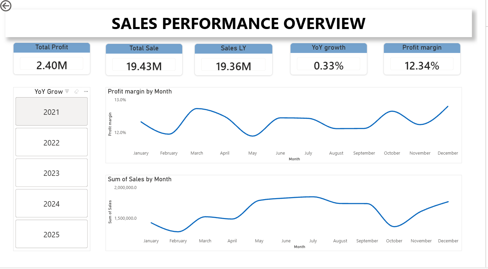
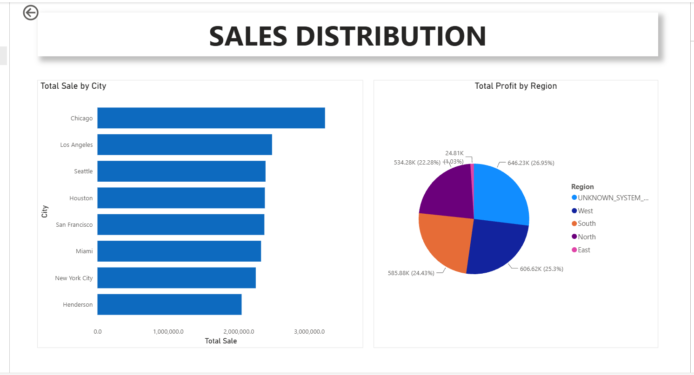

# Sales Performance Dashboard

An end-to-end Business Intelligence project on deliberately messy Superstore-style sales data. I cleaned and modeled the data in **SQL Server** and built a two-page interactive **Power BI** report on top of it.

**[▶ Open the live interactive dashboard](https://app.powerbi.com/view?r=eyJrIjoiMDFhODc4NTItYjhmYy00Y2MyLTgzZjctM2EzNjBlZGE1MGIzIiwidCI6ImY1MmYyMTgzLTlmNjctNGFkMi1iNjU2LTZmNzU0ZmUxOTZjYiIsImMiOjZ9&pageName=b06f71cf8e2f1591a186)**: use the year slicer and click the charts to filter the report.
## 🎯 Business Question

Where do sales and profit come from, by month, city and region, and is the business growing year over year? The source data is deliberately messy, so the first question is whether it can be trusted at all.

---

## 📊 Dashboard

### Page 1: Sales Performance Overview

KPI cards for Total Profit, Total Sale, Sales LY, YoY growth and Profit margin, a year slicer, and monthly trend lines for profit margin and for sales.

### Page 2: Sales Distribution

Total sale by city and total profit by region.

---

## 🔍 What the Dashboard Shows

Figures below are read from the screenshots above.

- **Headline numbers:** 19.43M in sales, 2.40M in profit, a 12.34% profit margin.
- **Margin is steady.** The monthly profit margin stays between roughly 11.9% and 12.9% all year, lowest in May and highest in March and December.
- **Sales have a clear seasonal shape.** Monthly sales dip to roughly 1.3M in February and October and peak at roughly 1.8M around June and July.
- **Chicago is the biggest city by sales** at roughly 3.2M, followed by Los Angeles at roughly 2.5M. The other six cities in the chart are close together at roughly 2.0M to 2.4M.

---

## 🗄️ Data Model

The report model has one fact table and two dimensions: `FactSales`, `DimDate` and `DimTerritory`. It is a subset of the warehouse that `Table script.sql` builds:

| Object | Type | Description | Used in report |
|--------|------|-------------|----------------|
| `FactSales` | Fact Table | Sales transactions and measures | Yes |
| `DimDate` | Dimension | Role-playing date dimension built from `Order_Date`, `Ship_Date`, and `Date_Entry` | Yes |
| `DimTerritory` | Dimension | City, state, postal code and region | Yes |
| `DimCustomer` | Dimension | Customer information | No |
| `DimProduct` | Dimension | Product details | No |
| `DimOrder` | Dimension | Order-level attributes linked by `Order_ID` | No |
| `DimShipment` | Dimension | Ship modes | No |

`DimDate` is a **single-column role-playing dimension** built with a `UNION` of **Order_Date**, **Ship_Date**, and **Date_Entry**, so all date filtering goes through one date table.

---

## 🧹 Data Quality & Modeling Challenges

### Data cleaning summary

The raw extract has 16,000 rows. Issues found and handled in `Table script.sql`:

| Issue | Rows affected | Fix |
|-------|---------------|-----|
| Misspelled or non-standard categories (e.g. `Furnitree`, `Offis Suply`, `Phonesss`) | 1,787 | Mapped to Furniture / Office Supplies / Technology |
| Inconsistent sub-category casing and spacing | 28 variants → 14 | `TRIM` + proper case |
| Placeholder phone numbers (`phone_number_hidden`, `000-000-0000`, …) | 803 | Set to `NULL` |
| Invalid product IDs | 312 | Grouped as `UNKNOWN_PROD` |
| Invalid postal codes (`NULL_ZIP`, `ABCDE`, `0`) | 477 | Grouped as `UNKNOWN_ZIP` |
| Unparseable or out-of-range dates (e.g. year 1900 / 2099) | 31 | `TRY_CAST`; excluded from the date dimension |
| Region labelled `UNKNOWN_SYSTEM_VAL` | 2,394 | Region re-derived from State |

### Unreliable Source Region Field

**Problem**

Cross-tabulating State against the source `Region` column showed that every state is spread almost evenly across all five region labels. For example, California rows are labelled East, North, South and West in nearly equal numbers, and Chicago, Illinois appears as "West."

**Solution**

`DimTerritory` derives Region from State in the SQL script instead of trusting the source field. The published report has not picked this up yet (see Known Limitations).

---

### Issues from the earlier six-table version of the model

These were found and fixed on an earlier version of the report that also used `DimCustomer`, `DimProduct` and `DimOrder`.

**$353K sales reconciliation gap.** Dashboard totals did not match the regional sales breakdown. Blank (`''`) Region values were not captured by the existing `NULL` check, so the fallback logic failed. Applying `NULLIF()` made blank strings and `NULL` values behave the same way.

**Ambiguous model relationship.** `FactSales` and `DimOrder` were related through both `Order_ID` and `Order_Date`, creating multiple filter paths. Removing `Order_Date` from `DimOrder` left `Order_ID` as the single key.

**Year-over-year growth measure.** Without a year filter, `SAMEPERIODLASTYEAR()` compared pooled sales from all selected years against pooled prior-period sales. A `HASONEVALUE()` guard made the measure only calculate when a single year is selected.

---

## ⚠️ Known Limitations

- **Region chart:** the "Total Profit by Region" pie still shows the source field's `UNKNOWN_SYSTEM_VAL` value as a slice (about 27% of profit), so it has not picked up the State-derived Region from the SQL script. Until `DimTerritory` is reloaded from the script, read the region split as unreliable.
- **Year-over-year growth:** YoY growth and Sales LY depend on the year slicer. Read them with a single year selected.
- **Unknown postal codes:** `DimTerritory` keeps one row per postal code, so every `UNKNOWN_ZIP` order is assigned to the same single city and state.
